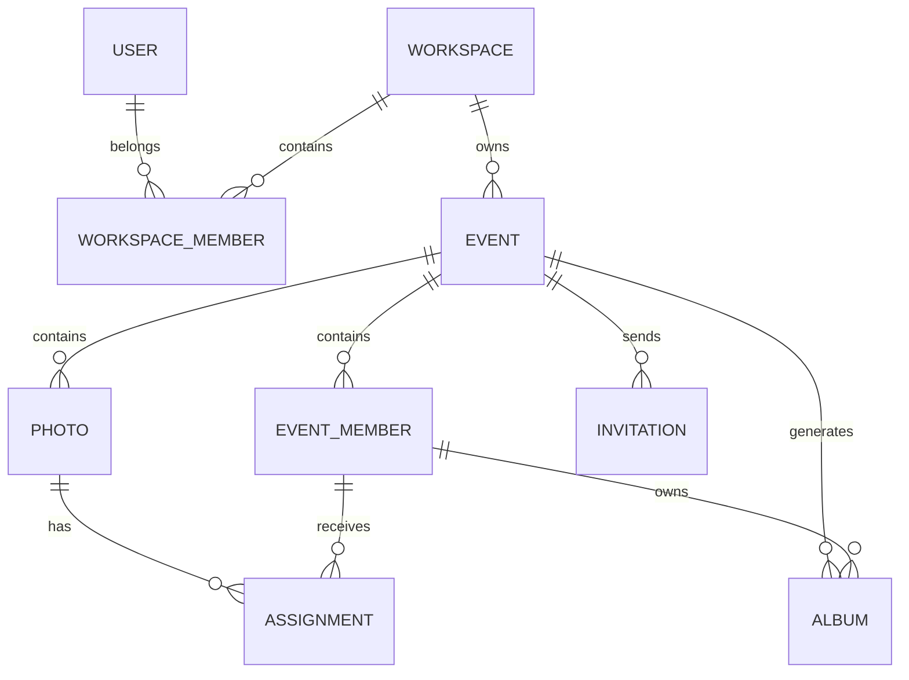

# MEMORIA — Conversation source (archive fidèle)

> **Statut : référence principale du projet.** Ce fichier archive le texte de la conversation ChatGPT
> « Idées pour application photo mariage » dans laquelle MEMORIA a été conçu
> (lien partagé : <https://chatgpt.com/share/6af3a656-3ea8-83ea-9c74-62ea9db03011>, lu intégralement le 11 novembre 2026).
>
> **Fidélité.** Le texte des 10 messages est reproduit tel quel, extrait automatiquement de la page partagée. Seules adaptations de forme :
> les titres internes sont décalés de deux niveaux pour tenir dans ce fichier ; les images d'illustration insérées par ChatGPT
> (photos d'ambiance trouvées sur le web, sans contenu propre au projet) sont omises ; les deux documents longs et les deux prompts
> encadrés sont remplacés par un renvoi vers leur copie intégrale ; le suivi de tâches interactif du message 6 est restitué en liste.
>
> **Ne pas modifier ce fichier** : les évolutions du projet se documentent dans les autres fichiers de `DOCUMENTATION/`.


---

## Message 1 — Utilisateur (Wael)

> Je suis un photographe de mariage événement photing et au même temp développeur 
> Jai une idee pour une idee de cree une application qui contient un book contenet les image de lun de ces chose 
> Exemple apres le mariage je prends les image apres le montage et je mettre dans le site il cree un book dans les étoiles de cielle chaque de ces persone avec son gmail con il connect il trouve leuur book 
> Donner moi des idee a ce projet

---

## Message 2 — ChatGPT

Ton idée est vraiment intéressante. Et je pense qu'il y a un potentiel pour en faire bien plus qu'un simple site de partage de photos.

Tu pourrais créer une véritable plateforme de **Wedding & Event Memories**, où chaque mariage ou événement devient un univers numérique privé, avec une expérience visuelle exceptionnelle.

J'aime particulièrement ton idée des étoiles dans le ciel : au lieu d'avoir une galerie classique avec des centaines de photos, chaque invité découvre son propre espace, comme un souvenir qui lui appartient.

Je te propose de développer le concept.

### 1. Le concept : un ciel rempli de souvenirs

**Nom provisoire : MEMORIA — Every moment deserves a place in the stars.**

Chaque événement possède son propre univers :

- Un mariage = une constellation.
- Chaque invité = une étoile.
- Chaque étoile = un accès personnel à ses souvenirs.
- Chaque photo = un instant de cette histoire.

##### Comment ça fonctionne ?

1. Tu photographies un mariage.
2. Tu effectues le tri et la retouche des photos.
3. Tu crées un événement dans ton espace photographe.
4. Tu importes les photos et renseignes les invités (Gmail).
5. La plateforme génère automatiquement un book élégant.
6. Chaque invité reçoit un lien par email.
7. Il se connecte avec Google et découvre son espace personnel.

L'invité peut retrouver ses photos, télécharger ses souvenirs et partager certaines images selon les autorisations définies.

### 2. L'expérience côté invité

#### 01 — Entrer dans son univers

Une page d'accueil immersive avec le nom des mariés, la date du mariage et un ciel étoilé animé.

---

#### 02 — Découvrir son étoile

Chaque invité retrouve son étoile avec son prénom ou un identifiant. En cliquant dessus, son album s'ouvre.

---

#### 03 — Son album photo

Les photos sont présentées comme un magazine photographique, avec une navigation fluide et une visionneuse plein écran.

---

#### 04 — Télécharger ses souvenirs

Téléchargement individuel ou par sélection, en haute résolution selon les droits accordés.

### 3. Les fonctionnalités qui rendraient ton application spéciale

Voici les idées que je te recommande d'intégrer progressivement.

#### A. Personnalisation intelligente des albums

(Fonctionnalité importante)

Imagine que tu photographies un mariage de 250 invités.

Tu peux proposer trois niveaux d'accès :

| Type | Accès |
|--------|--------|
| Mariés | Toutes les photos |
| Invité | Son album personnel |
| Famille proche | Album familial et photos partagées avec elle |

Tu pourrais également ajouter :

- **Mes photos** : les photos dans lesquelles l'invité apparaît.
- **Photos de groupe** : les photos avec ses proches.
- **Moments du mariage** : cérémonie, entrée, soirée, gâteau, danse…
- **Album collectif** : toutes les photos autorisées par les mariés.

Une idée supplémentaire : permettre au photographe de sélectionner manuellement les photos de chaque invité. Plus tard, tu pourrais proposer une reconnaissance faciale avec consentement explicite, pour automatiser cette tâche.

#### B. Un QR Code pour chaque événement

Imagine un QR code imprimé sur les invitations ou placé à l'entrée du mariage.

Les invités le scannent et arrivent directement sur la page du mariage.

Ils peuvent :

- Se connecter avec Google.
- Retrouver leur album.
- Voir les photos autorisées.
- Recevoir une notification lorsque de nouvelles photos sont disponibles.

#### C. Une expérience encore plus émotionnelle

Quelques fonctionnalités originales :

- **Timeline** : revivre le mariage chronologiquement.
- **Photo of the day** : une photo mise en avant chaque jour.
- **Message des mariés** : une vidéo ou un petit texte de remerciement.
- **Livre de souvenirs** : les invités peuvent laisser un message.
- **Favoris** : sauvegarder les photos préférées.
- **Diaporama cinéma** : regarder les photos avec une transition élégante.
- **Album souvenir téléchargeable** : créer un PDF personnalisé.

#### D. Le côté photographe : ton véritable outil professionnel

C'est une partie très importante. Ton application doit aussi te faire gagner du temps.

Je vois un tableau de bord avec :

| Section | Fonction |
|--------|--------|
| Dashboard | Statistiques et événements |
| Événements | Créer et gérer les mariages |
| Galerie | Importer et organiser les photos |
| Invités | Gérer les emails et les accès |
| Albums | Générer les books |
| Partage | Liens privés et QR codes |
| Statistiques | Téléchargements et vues |
| Paramètres | Logo, couleurs, branding |

**Une fonctionnalité particulièrement intéressante :**

Tu importes 800 photos, tu sélectionnes les photos d'un invité et la plateforme lui attribue automatiquement son album.

Tu n'as pas besoin de créer manuellement 100 sites différents : tout est généré à partir d'un seul événement.

### 4. Une fonctionnalité qui pourrait différencier ton projet

#### Le mode « Find Me »

(Idée à fort potentiel)

L'invité ouvre le site et clique sur « Trouve mes photos ».

Il prend un selfie ou importe une photo de lui-même.

Le système recherche les photos correspondantes dans la galerie de l'événement, puis lui présente les résultats.

Attention : cette fonctionnalité implique le traitement de données biométriques potentiellement sensibles. Il faudrait un consentement explicite, des règles de conservation strictes et une conformité juridique adaptée, notamment en Tunisie et selon les pays concernés.

Pour la première version, je privilégierais une attribution manuelle des photos.

### 5. Architecture technique que je te conseille

Puisque tu développes déjà avec React et Firebase, tu peux réutiliser une bonne partie de ton expérience.

#### Architecture proposée

**Application Web / PWA**

React + Vite + Tailwind CSS

**Firebase**

**Authentication**

Google Login

**Firestore**

Événements et invités

**Storage**

Photos et miniatures

**Security Rules**

Accès privés

**Expérience personnalisée**

Book · Galerie · Téléchargement · Partage

##### Structure de données possible

```text
users/
  userId
    name
    email
    role

events/
  eventId
    title
    date
    cover
    photographerId
    status

events/eventId/guests/
  guestId
    email
    name
    accessLevel

events/eventId/photos/
  photoId
    storagePath
    thumbnailPath
    category

events/eventId/albums/
  albumId
    guestId
    photoIds[]
```

Important : les règles de sécurité doivent vérifier l'identité de l'utilisateur, son invitation et son autorisation sur chaque événement. Un simple identifiant d'album ou une URL difficile à deviner ne constitue pas une protection.

Pour les photos, il faudra aussi réfléchir à la compression, aux miniatures, au chargement progressif et au coût des téléchargements. Le stockage et surtout le trafic sortant peuvent devenir les principaux coûts avec plusieurs centaines d'invités.

### 6. Comment transformer cette idée en business ?

Je ne limiterais pas cette application à ton utilisation personnelle.

Tu pourrais la proposer à d'autres photographes et vidéastes.

Voici trois modèles commerciaux :

| Offre | Contenu |
|--------|--------|
| Starter | 1 événement, galerie collective |
| Premium | Albums individuels, QR codes, personnalisation |
| Studio | Plusieurs photographes, branding personnalisé, statistiques |

Tu pourrais aussi facturer par événement plutôt que par abonnement. C'est intéressant pour les photographes qui ne réalisent que quelques mariages par an.

Exemple de tarifs à tester en Tunisie (à valider avec le marché) :

- Starter : 39 DT / événement
- Premium : 79 DT / événement
- Studio : 149 DT / événement

Tu pourrais proposer les premiers événements gratuitement pour attirer des photographes.

### 7. Comment je construirais la première version ?

Je ne commencerais pas directement avec toutes les fonctionnalités.

1. **Phase 1 — MVP**
   
   - Connexion Google.
   - Espace photographe.
   - Création d'événements.
   - Importation de photos.
   - Gestion des invités.
   - Attribution manuelle des photos.
   - Albums privés.
   - Téléchargement.
2. **Phase 2 — Expérience immersive**
   
   - Ciel étoilé interactif.
   - Étoiles personnalisées.
   - Animations.
   - Timeline.
   - QR codes.
   - Messages des mariés.
3. **Phase 3 — Intelligence artificielle**
   
   - Find Me.
   - Reconnaissance des visages avec consentement.
   - Classement automatique.
   - Recherche intelligente.
4. **Phase 4 — Commercialisation**
   
   - Abonnements.
   - Gestion de plusieurs photographes.
   - Personnalisation avec leur propre logo.
   - Paiement et facturation.

### 8. Quelques idées de noms

**MEMORIA**

Every moment lives forever.

**STELLARA**

Your memories, your universe.

**EVERORA**

Moments that never fade.

**ASTRIA**

A universe of memories.

---

### 9. Mon conseil : définissons précisément le produit

Il y a une décision très importante à prendre avant de commencer le développement.

### Définissons ton application

**1. À qui veux-tu proposer la plateforme ?**

Uniquement pour mon activité de photographe

Pour moi et les autres photographes (SaaS)

Une plateforme ouverte à tous les photographes

---

**2. Comment les invités doivent-ils retrouver leurs photos ?**

Chaque invité possède son album personnel

Tous les invités accèdent à la galerie complète

Les deux : album personnel + galerie collective

---

**3. Quel univers visuel souhaites-tu ?**

Ciel étoilé, constellations et étoiles interactives

Magazine de photographie haut de gamme

Combiner les deux selon l'événement

---

**4. Quelle plateforme ?**

Site web responsive (mobile + ordinateur)

Site web installable comme une application

Web + application mobile native

*[Bouton : Valider mes choix]*

*(Questionnaire interactif : trois options par question ; les réponses de Wael figurent dans le message 3.)*

**Mon intuition :** le vrai produit différenciant n'est pas simplement une galerie photo. C'est une expérience dans laquelle chaque invité a l'impression de recevoir un cadeau numérique personnalisé après un événement important de sa vie. C'est cette expérience qu'il faut construire.

---

## Message 3 — Utilisateur (Wael)

> Voici mes choix pour mon projet de plateforme photo : clientèle = both ; accès aux photos = both ; design = stars ; plateforme = web. Construis le cahier des charges fonctionnel et technique détaillé du projet.

---

## Message 4 — ChatGPT

Je vais structurer ton projet comme un véritable produit SaaS professionnel, destiné à deux publics :

1. **Les photographes et vidéastes** : ils utilisent la plateforme pour gérer leurs événements, importer leurs photos, organiser les albums et inviter leurs clients.
2. **Les invités et les clients** : ils découvrent leurs souvenirs dans un univers immersif, consultent leur album personnel ou la galerie collective et téléchargent leurs photos.

Je retiens tes quatre décisions :

- Clientèle : toi et les autres photographes.
- Accès : albums personnels + galerie collective.
- Identité visuelle : ciel étoilé, constellations et animations.
- Plateforme : application web responsive, optimisée pour mobile et ordinateur.

Mon conseil architectural : construire une seule plateforme multi-photographes, avec une séparation stricte des données de chaque photographe et de chaque événement. Cela évite de développer un site différent pour chaque client.

### Cahier des charges — Projet de plateforme photographique

(Document de référence V1.0) (11 novembre 2026)

### MEMORIA

#### Every moment deserves a place in the stars.

**Nature du produit :** plateforme SaaS de livraison, de gestion et de partage privé de photographies d'événements.

**Cible :** photographes indépendants, studios photo, vidéastes, mariés et invités.

**Objectif :** transformer les photographies d'un événement en une expérience numérique personnalisée et mémorable.

> **[Document intégré par ChatGPT — « MEMORIA — Cahier des charges fonctionnel et technique », V1.0]**
> Reproduit à l'identique dans [`02_CAHIER_DES_CHARGES.md`](02_CAHIER_DES_CHARGES.md).

#### 23. Mes recommandations avant le développement

Je recommande de prendre cinq décisions techniques dès le départ :

1. **Multi-tenant dès la première version** : chaque photographe possède son workspace, sans mélange de données.
2. **Sécurité avant le design** : tester les autorisations des albums personnels avant de développer les animations.
3. **Pas de reconnaissance faciale au MVP** : l'attribution manuelle est suffisante pour valider le produit.
4. **Optimisation des photos dès l'importation** : ne jamais servir systématiquement les originaux.
5. **Mobile-first** : la majorité des invités consulteront leurs souvenirs sur leur téléphone.

##### Ordre de réalisation recommandé

**Premier objectif** (Priorité 1)

### Un mariage entièrement fonctionnel

Construire un événement de démonstration avec :

- 1 photographe.
- 1 mariage.
- 10 invités.
- 100 photographies.
- 10 albums personnels.
- 1 galerie collective.

---

**Test de réussite :** chaque invité se connecte avec son Gmail, retrouve ses photos et ne peut pas consulter celles des autres sans autorisation.

Cette première démonstration permettra de valider le produit avant d'investir dans les animations complexes et les fonctionnalités SaaS.

**Prochaine étape :** je te propose de transformer ce cahier des charges en architecture technique détaillée, avec l'arborescence complète React, les collections Firebase, les règles Firestore/Storage et un backlog de développement découpé en tâches pour ton agent Claude Code ou Codex.

---

## Message 5 — Utilisateur (Wael)

> Oui

---

## Message 6 — ChatGPT

Parfait. On passe maintenant de l'idée au **plan technique de développement de MEMORIA**.

Je vais préparer une architecture exploitable directement par Claude Code ou Codex dans VS Code, avec une attention particulière à la sécurité des albums privés, à l'isolation des photographes et aux coûts Firebase.

Je recommande de commencer par un monolithe modulaire React + Firebase plutôt que de multiplier les microservices. C'est plus simple à développer, tester et maintenir.

### Architecture technique MEMORIA

**Architecture cible** (MVP)

**Frontend**

React + TypeScript + Vite

**UI**

Tailwind + Framer Motion

**Database**

Cloud Firestore

**Auth**

Firebase Authentication

**Photos**

Firebase Storage

**Backend**

Cloud Functions si nécessaire

#### 1. Organisation générale du projet

Je recommande cette arborescence :

```text
memoria/
│
├── public/
│   ├── favicon.svg
│   ├── logo.svg
│   └── assets/
│
├── src/
│   ├── app/
│   │   ├── App.tsx
│   │   ├── router.tsx
│   │   └── providers/
│   │
│   ├── components/
│   │   ├── ui/
│   │   ├── layout/
│   │   ├── forms/
│   │   ├── gallery/
│   │   └── celestial/
│   │
│   ├── features/
│   │   ├── auth/
│   │   ├── photographer/
│   │   ├── workspaces/
│   │   ├── events/
│   │   ├── photos/
│   │   ├── albums/
│   │   ├── guests/
│   │   ├── invitations/
│   │   ├── favorites/
│   │   ├── analytics/
│   │   └── platform-admin/
│   │
│   ├── pages/
│   │   ├── public/
│   │   ├── photographer/
│   │   ├── guest/
│   │   └── admin/
│   │
│   ├── services/
│   │   ├── firebase/
│   │   ├── storage/
│   │   ├── email/
│   │   └── media/
│   │
│   ├── hooks/
│   ├── contexts/
│   ├── types/
│   ├── utils/
│   ├── constants/
│   └── styles/
│
├── functions/
│   └── src/
│       ├── invitations/
│       ├── media/
│       ├── analytics/
│       └── index.ts
│
├── tests/
│   ├── unit/
│   ├── integration/
│   ├── security/
│   └── e2e/
│
├── firebase.json
├── firestore.rules
├── firestore.indexes.json
├── storage.rules
├── .env.example
├── package.json
└── README.md
```

**Principe important :** chaque fonctionnalité possède ses composants, ses hooks, ses services et ses types. On évite un énorme fichier qui mélange toute la logique.

#### 2. Modèle de données Firestore

Je propose une structure multi-tenant avec des collections séparées pour les utilisateurs, les photographes, les événements et les invités.

##### Structure recommandée

```text
users/{uid}
    displayName
    email
    photoURL
    createdAt
    platformRole
    accountStatus

workspaces/{workspaceId}
    ownerUid
    name
    slug
    logoPath
    plan
    status
    storageUsed
    createdAt

workspaces/{workspaceId}/members/{uid}
    role
    permissions
    status

events/{eventId}
    workspaceId
    title
    slug
    eventType
    date
    location
    description
    coverPath
    theme
    status
    createdAt

events/{eventId}/members/{uid}
    role
    email
    displayName
    invitationStatus
    joinedAt

events/{eventId}/invitations/{invitationId}
    email
    tokenHash
    status
    expiresAt
    createdAt

events/{eventId}/photos/{photoId}
    workspaceId
    originalPath
    displayPath
    thumbnailPath
    filename
    category
    visibility
    published
    createdAt

events/{eventId}/photos/{photoId}/assignments/{uid}
    assignedBy
    assignedAt

events/{eventId}/albums/{albumId}
    guestUid
    title
    createdAt

events/{eventId}/favorites/{favoriteId}
    guestUid
    photoId
    createdAt

events/{eventId}/analytics/{periodId}
    views
    downloads
    activeGuests
    updatedAt
```

##### Pourquoi cette structure ?

Trois choix sont particulièrement importants.

**1. Ne pas enregistrer toutes les photos dans un tableau `photoIds[]` de l'album.**

Un événement peut contenir plusieurs milliers de photographies. Les documents Firestore ont une limite de 1 Mio et les tableaux deviennent difficiles à gérer.

Les sous-collections `assignments` permettent d'associer les photos aux invités individuellement.

**2. Ne pas considérer un album comme une autorisation.**

L'accès doit être vérifié pour chaque photo. Un utilisateur ne doit pas pouvoir changer un `guestUid` dans une requête et obtenir les photos d'une autre personne.

**3. Séparer les membres de l'événement des invités.**

Le photographe, les collaborateurs, les mariés et les invités ont des permissions différentes.

##### Relations entre les données



#### 3. Sécurité Firebase

C'est la partie la plus importante de MEMORIA.

##### Règles métier

| Action | Photographe propriétaire | Collaborateur | Invité |
|--------|--------|--------|--------|
| Créer événement | Oui | Selon permission | Non |
| Importer photos | Oui | Selon permission | Non |
| Attribuer photos | Oui | Selon permission | Non |
| Voir photos privées | Oui | Selon permission | Selon attribution |
| Voir galerie collective | Oui | Selon permission | Si autorisé |
| Supprimer événement | Oui | Non | Non |
| Gérer invités | Oui | Selon permission | Non |

##### Contrôle des accès

Je recommande trois niveaux de contrôle :

- Firebase Authentication identifie l'utilisateur.
- Firestore Security Rules vérifient son appartenance et ses permissions.
- Les opérations sensibles passent par des fonctions backend vérifiant à nouveau les autorisations.

Exemple de logique pour une lecture de photo :

```text
Utilisateur connecté ?
    |
    NON → Refus
    |
    OUI
    |
Est-il propriétaire ou collaborateur autorisé ?
    |
    OUI → Accès autorisé
    |
    NON
    |
Est-il membre de cet événement ?
    |
    NON → Refus
    |
    OUI
    |
La photo est-elle collective et publiée ?
    |
    OUI → Accès autorisé
    |
    NON
    |
Existe-t-il une attribution à son UID ?
    |
    OUI → Accès autorisé
    |
    NON → Refus
```

##### Gestion des photos privées

Je conseille de ne pas utiliser directement les URL publiques Firebase Storage comme mécanisme d'autorisation.

Architecture recommandée :

1. Les fichiers restent privés dans Storage.
2. Le client demande l'accès à une photo.
3. Une fonction backend vérifie l'identité, l'événement et l'attribution.
4. Elle génère une URL signée de courte durée, par exemple 5 minutes.
5. Le navigateur affiche la photo avec cette URL.

Les règles Storage doivent interdire les lectures directes non autorisées. Les fonctions backend doivent également vérifier les limites d'utilisation et les permissions.

Pour le MVP, l'optimisation et la génération des miniatures peuvent se faire dans le navigateur avant l'importation, sans déclencher une fonction payante pour chaque image.

#### 4. Architecture des albums et des images

Je recommande trois versions de chaque photographie :

**Original**

(Privé)

Qualité maximale, téléchargement autorisé selon l'offre.

---

**Display**

(Galerie)

Version optimisée pour l'affichage et la visionneuse.

---

**Thumbnail**

(Miniature)

Petite image pour les grilles et les aperçus rapides.

##### Exemple de workflow

```text
Importation de 100 photos
          |
          v
Vérification des fichiers
          |
          v
Optimisation locale
          |
          v
Génération de 3 versions
          |
          v
Upload Storage
          |
          v
Enregistrement Firestore
          |
          v
Attribution aux invités
          |
          v
Publication des albums
```

Les fichiers doivent être importés avec une gestion fiable des reprises et des erreurs. Une photo n'est considérée comme publiée que lorsque ses versions nécessaires sont disponibles et que ses métadonnées ont été enregistrées.

#### 5. Les pages à développer

| Route | Page | Accès |
|--------|--------|--------|
| `/` | Landing page | Public |
| `/pricing` | Tarifs | Public |
| `/login` | Connexion | Public |
| `/register` | Inscription photographe | Public |
| `/dashboard` | Tableau de bord | Photographe |
| `/dashboard/events` | Événements | Photographe |
| `/dashboard/events/new` | Créer événement | Photographe |
| `/dashboard/events/:id` | Gestion événement | Photographe |
| `/dashboard/events/:id/photos` | Galerie administrative | Photographe |
| `/dashboard/events/:id/guests` | Invités | Photographe |
| `/dashboard/events/:id/albums` | Albums | Photographe |
| `/my-events` | Mes événements | Invité |
| `/event/:slug` | Univers étoilé | Invité autorisé |
| `/event/:slug/my-album` | Album personnel | Invité |
| `/event/:slug/gallery` | Galerie collective | Invité autorisé |
| `/platform-admin` | Administration globale | Super administrateur |

Les routes ne constituent pas une protection : chaque lecture et chaque opération doivent être autorisées côté Firebase.

---

#### 6. Environnement de développement

Je recommande deux environnements distincts dès le début.

(Développement)

**MEMORIA Demo**

Projet Firebase local / Emulator Suite

- Tests Auth
- Firestore
- Storage
- Functions
- Données fictives

(Production)

**MEMORIA Production**

Projet Firebase séparé

- Vrais photographes
- Vrais événements
- Vraies invitations
- Sauvegardes

Utilise notamment :

```powershell
npm install
npm run dev
npm run build
npm run test
```

Les scripts de développement doivent pointer vers les émulateurs. Aucun test automatisé ne doit modifier la base de production.

Attention également : Firebase Storage et certaines fonctions nécessitent une configuration de facturation selon les conditions actuelles de Firebase. Il faut vérifier les exigences du projet avant de choisir l'offre. Les alertes budgétaires ne constituent pas un plafond automatique de dépenses.

#### 7. Backlog de développement pour Claude Code / Codex

Voici comment je découperais le travail pour éviter qu'un agent IA génère toute l'application d'un seul coup sans vérifier la sécurité.

#### Plan des tâches

*(Suivi de tâches interactif — contenu restitué ci-dessous.)*

1. **Phase 1 — Initialisation et architecture**
   - Créer le projet React + TypeScript + Vite
   - Configurer Tailwind et les composants UI
   - Configurer Firebase et les émulateurs
   - Créer les types et services de base
2. **Phase 2 — Authentification et workspace**
   - Connexion Google
   - Inscription photographe
   - Création du workspace
   - Gestion des rôles et permissions
   - Protection des routes
3. **Phase 3 — Gestion des événements**
   - Créer et modifier un événement
   - Gérer les statuts
   - Gérer les membres
   - Personnaliser l'événement
4. **Phase 4 — Photographies**
   - Importation multiple
   - Optimisation des images
   - Stockage privé
   - Miniatures et affichage
   - Attribution des photos
5. **Phase 5 — Invités et albums**
   - Importation CSV des invités
   - Invitations par email
   - Connexion et vérification Gmail
   - Albums personnels
   - Galerie collective
6. **Phase 6 — Expérience immersive**
   - Landing page étoilée
   - Univers de chaque événement
   - Navigation par constellations
   - Galerie immersive
   - Responsive mobile
7. **Phase 7 — Sécurité et tests**
   - Règles Firestore
   - Règles Storage
   - Tests d'accès croisés
   - Tests E2E
   - Audit des coûts et performances

**Ordre impératif :** ne pas commencer par les étoiles animées. Il faut d'abord réussir le parcours complet photographe → importation → attribution → connexion invité → album privé.

#### 8. Prompt principal pour ton agent IA

Ce prompt est conçu pour être utilisé dans VS Code avec Claude Code ou Codex.

> **[Document intégré par ChatGPT — « MISSION : CONSTRUIRE MEMORIA — PLATEFORME SAAS PHOTOGRAPHIQUE »]**
> Reproduit à l'identique dans [`../PROMPTS/PROMPT_INITIAL_CLAUDE.md`](../PROMPTS/PROMPT_INITIAL_CLAUDE.md).

#### 9. Ma recommandation : ne brûle pas les étapes

Je te conseille de créer d'abord un prototype avec un seul mariage de démonstration, puis de tester réellement l'expérience sur ton téléphone.

**Le premier jalon à atteindre :**

(Objectif MVP) Un photographe importe 100 photos, invite 10 personnes, et chacune retrouve son album privé après connexion Google.

Ensuite, on développe l'univers étoilé qui fera la différence.

J'ai volontairement privilégié une architecture React/Firebase économique et évolutive, plutôt qu'une infrastructure complexe dès le départ.

**Quand ton agent aura terminé son analyse initiale, transmets-moi son rapport : je pourrai vérifier son architecture, ses choix Firebase et ses failles de sécurité avant que tu lui autorises le développement.**

---

## Message 7 — Utilisateur (Wael)

> Comment je peux donner cette conversation a claude pour le lire attentivement et commencer a cree le projet

---

## Message 8 — ChatGPT

Je te conseille de transmettre à Claude **un document unique contenant toute la vision de MEMORIA, le cahier des charges, l'architecture technique et les consignes de développement**.

Évite de lui envoyer uniquement un résumé de la conversation : certaines décisions importantes risqueraient d'être perdues.

Voici la meilleure méthode avec Claude Code dans VS Code.

#### 1. Préparer les documents à transmettre

Dans ton futur projet, crée cette structure :

```text
MEMORIA/
│
├── DOCUMENTATION/
│   ├── 01_VISION_PROJET.md
│   ├── 02_CAHIER_DES_CHARGES.md
│   ├── 03_ARCHITECTURE_TECHNIQUE.md
│   └── 04_ROADMAP_DEVELOPPEMENT.md
│
├── PROMPTS/
│   └── PROMPT_INITIAL_CLAUDE.md
│
└── README.md
```

Tu peux copier le cahier des charges et le prompt que je viens de te préparer dans ces documents.

#### 2. La méthode que je recommande : donner les documents à Claude Code

1. Ouvre VS Code.
2. Crée un nouveau dossier `MEMORIA`.
3. Ajoute les documents de documentation.
4. Ouvre Claude Code dans VS Code.
5. Donne-lui le prompt ci-dessous.

#### 3. Prompt à envoyer à Claude

> **[Message proposé par ChatGPT — prompt « dossier DOCUMENTATION »]**
> Reproduit à l'identique dans l'annexe A de [`../PROMPTS/PROMPT_INITIAL_CLAUDE.md`](../PROMPTS/PROMPT_INITIAL_CLAUDE.md).

#### 4. Une dernière chose importante : donner le contexte permanent à Claude

Demande-lui de créer également un fichier :

`CLAUDE.md`

Ce fichier devra contenir :

- La vision de MEMORIA.
- Les technologies utilisées.
- Les règles de développement.
- Les décisions architecturales validées.
- Les contraintes de sécurité.
- Les commandes du projet.
- L'état actuel du développement.

Claude Code pourra ainsi retrouver les consignes importantes lorsqu'il travaillera sur le projet lors des prochaines sessions.

#### 5. Mon conseil pour la suite

Ne demande pas à Claude de construire immédiatement 20 fonctionnalités.

Commence par faire valider l'architecture, puis avance dans cet ordre :

1. **Architecture et configuration Firebase**
2. **Authentification et espaces photographes**
3. **Création et gestion des événements**
4. **Importation et optimisation des photos**
5. **Invités et albums privés**
6. **Univers étoilé et expérience immersive**
7. **Tests, sécurité et lancement**

**Je te recommande de commencer avec Claude Code dans VS Code, et de conserver toute la documentation dans le dépôt GitHub de MEMORIA.** Ainsi, Claude et Codex pourront travailler sur le même projet sans perdre les décisions importantes.

Quand Claude aura produit `RAPPORT_ANALYSE_CLAUDE.md`, envoie-le-moi : nous vérifierons son plan avant de lui donner le feu vert.

---

## Message 9 — Utilisateur (Wael)

> Si je partage le lien esque il peux lire la discussion

---

## Message 10 — ChatGPT

Oui ! Tu peux partager cette conversation avec Claude via un lien ChatGPT partagé, mais il y a une distinction importante.

1. Dans ChatGPT, ouvre cette conversation.
2. Appuie sur **Partager** en haut de la conversation.
3. Choisis **Créer un lien**.
4. Copie le lien.
5. Envoie-le à Claude.

**Attention :** le lien partagé permet de consulter une copie de la conversation, mais Claude ne possède pas automatiquement accès à ton compte ChatGPT ni à tes autres conversations.

##### Prompt à envoyer à Claude

> **[Message proposé par ChatGPT — prompt « lien de conversation partagé »]**
> Reproduit à l'identique dans l'annexe B de [`../PROMPTS/PROMPT_INITIAL_CLAUDE.md`](../PROMPTS/PROMPT_INITIAL_CLAUDE.md).

**Mon conseil :** teste d'abord le lien dans une fenêtre de navigation privée pour vérifier qu'il affiche bien toute la conversation avant de l'envoyer à Claude. Évite d'y inclure des informations confidentielles.
