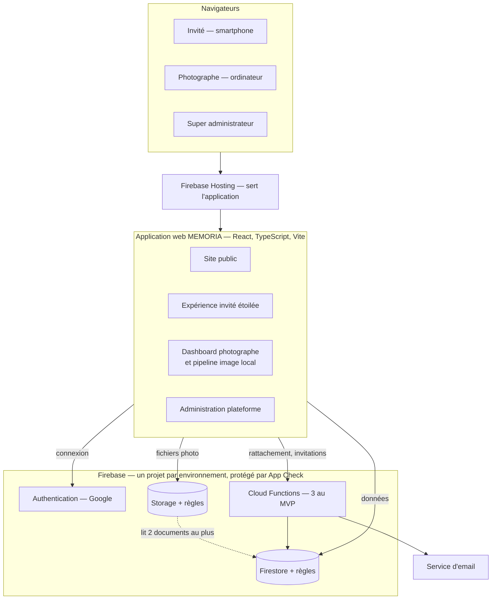
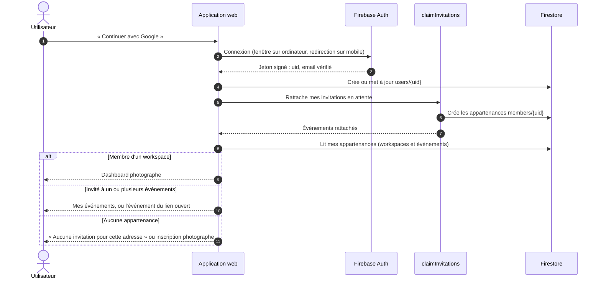
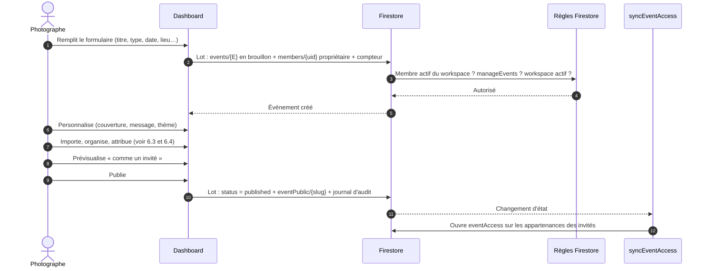
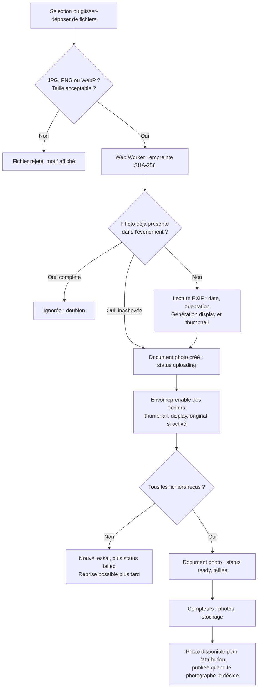
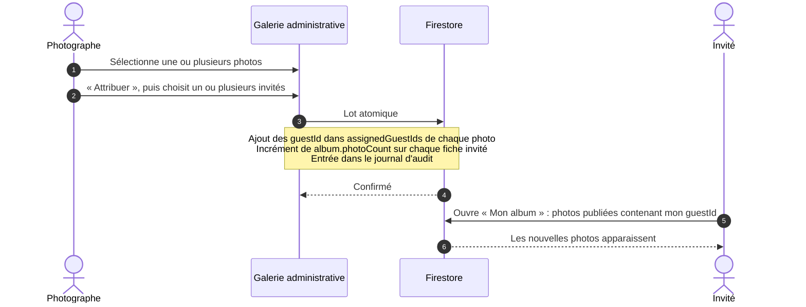
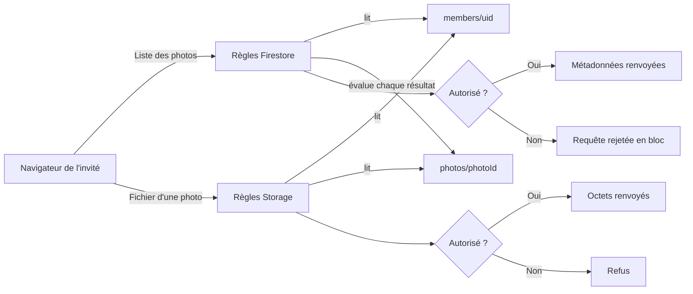
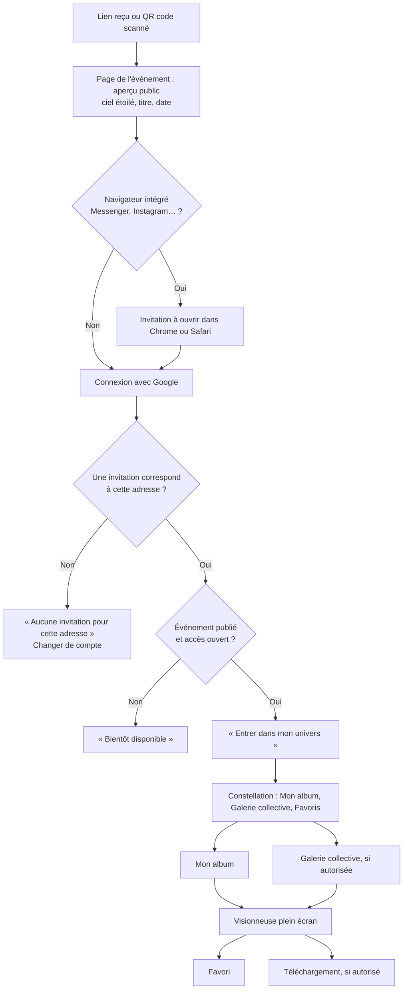

# MEMORIA — Architecture technique (ARCHITECTURE)

> **Statut : proposé, en attente de validation.** Reprend l'architecture du message 6 de la [conversation source](00_CONVERSATION_SOURCE.md) et y intègre les corrections du [rapport d'analyse](RAPPORT_ANALYSE_CLAUDE.md). Les écarts avec la conversation sont signalés par **[écart]**.

## 1. Principes

1. **Monolithe modulaire.** Une seule application web React et un seul projet Firebase par environnement. Pas de microservices.
2. **Une plateforme, des workspaces.** Chaque photographe a son espace ; l'isolation est assurée par les règles de sécurité, pas par des déploiements séparés.
3. **Les règles sont la barrière.** L'interface et les routes n'autorisent rien : chaque lecture et chaque écriture est contrôlée par les règles Firestore et Storage.
4. **Cloud Functions seulement quand il le faut.** Trois fonctions au MVP, aucune dans le chemin de lecture des photos.
5. **Le navigateur du photographe fait le travail lourd.** Redimensionnement, compression et empreinte des fichiers avant envoi.
6. **Mobile d'abord pour l'invité, ordinateur d'abord pour le photographe.**
7. **Un découpage par fonctionnalité.** Chaque fonctionnalité possède ses composants, ses hooks, ses services et ses types.

## 2. Vue d'ensemble



Chaque espace de l'application parle directement à Firebase ; il n'y a pas de serveur applicatif intermédiaire. App Check accompagne chaque requête vers Firestore, Storage et Functions.

## 3. Stack et versions

Stack imposée par la conversation (cahier §11, prompt §2), avec les versions stables constatées sur le registre npm le 11 novembre 2026. Les versions exactes seront figées par le fichier de verrouillage à l'initialisation.

| Rôle | Bibliothèque | Version constatée |
|---|---|---|
| Interface | React, React DOM | 19.3 |
| Langage | TypeScript | 7.0 |
| Outil de build | Vite | 8.3 |
| Styles | Tailwind CSS (+ `@tailwindcss/vite`) | 4.3 |
| Routage | React Router | 8.5 |
| Animations | Framer Motion, distribué sous le nom `motion` | 14.12 |
| Icônes | Lucide (`lucide-react`) | 1.71 |
| SDK Firebase web | `firebase` | 13.2 |
| Outils Firebase et émulateurs | `firebase-tools` | 15.35 |
| Functions | `firebase-functions`, `firebase-admin` | 7.4, 14.5 |
| Tests unitaires | Vitest, React Testing Library | 5.1, 16.3 |
| Tests de règles | `@firebase/rules-unit-testing` | 6.0 |
| Tests de bout en bout | Playwright | 1.65 |

**[écart] Ajouts proposés (D-12)** : TanStack Query 5 (cache et pagination), Zod 4 (validation), React Hook Form 7, i18next 27 (traductions), exifr 7 (métadonnées EXIF), fflate 0.8 (ZIP dans le navigateur), qrcode (QR code local).

Environnement vérifié : Node.js 22.23, npm 10.9, OpenJDK 21.

Plusieurs de ces versions majeures sont récentes (TypeScript 7, Vite 8, React Router 8, Firebase 13). Leur documentation sera relue à l'initialisation ; en cas d'incompatibilité d'outillage, repli sur la version majeure précédente.

## 4. Arborescence

Celle du message 6, conservée. Les ajouts sont marqués `+`.

```text
memoria/
├── CLAUDE.md                      + contexte permanent pour les sessions de développement
├── README.md
├── DOCUMENTATION/                 + documents de référence
├── PROMPTS/                       + prompts d'origine
├── .github/workflows/             + intégration continue
│
├── public/
│   ├── favicon.svg
│   ├── logo.svg
│   └── assets/
│
├── src/
│   ├── app/
│   │   ├── App.tsx
│   │   ├── router.tsx
│   │   └── providers/
│   ├── components/
│   │   ├── ui/
│   │   ├── layout/
│   │   ├── forms/
│   │   ├── gallery/
│   │   └── celestial/
│   ├── features/
│   │   ├── auth/
│   │   ├── photographer/
│   │   ├── workspaces/
│   │   ├── events/
│   │   ├── photos/
│   │   ├── albums/
│   │   ├── guests/
│   │   ├── invitations/
│   │   ├── favorites/
│   │   ├── analytics/
│   │   └── platform-admin/
│   ├── pages/
│   │   ├── public/
│   │   ├── photographer/
│   │   ├── guest/
│   │   └── admin/
│   ├── services/
│   │   ├── firebase/
│   │   ├── storage/
│   │   ├── email/
│   │   └── media/
│   ├── workers/                   + traitement d'image hors du fil principal
│   ├── i18n/                      + traductions (fr au lancement)
│   ├── hooks/
│   ├── contexts/
│   ├── types/
│   ├── utils/
│   ├── constants/
│   └── styles/
│
├── functions/
│   └── src/
│       ├── invitations/
│       ├── media/
│       ├── analytics/
│       └── index.ts
│
├── scripts/                       + jeu de données de démo, outils d'administration
│
├── tests/
│   ├── unit/
│   ├── integration/
│   ├── security/
│   └── e2e/
│
├── firebase.json
├── .firebaserc                    +
├── firestore.rules
├── firestore.indexes.json
├── storage.rules
├── cors.json                      + configuration CORS du bucket
├── .env.example
├── package.json
└── README.md
```

Règles de dépendance entre dossiers :

- `features/*` peut importer `components/ui`, `services`, `hooks`, `types`, `utils`. Une fonctionnalité n'importe pas le code interne d'une autre : elle passe par son fichier d'export.
- `pages/*` assemble des fonctionnalités ; aucune logique métier.
- `services/firebase` est le seul endroit qui initialise Firebase et choisit entre émulateurs et production.
- `services/storage` est le seul endroit qui lit un fichier privé (voir §9).

## 5. Routes

Tableau du message 6, conservé. Ajouts marqués `+`.

| Route | Page | Accès |
|---|---|---|
| `/` | Page d'accueil | Public |
| `/pricing` | Tarifs | Public |
| `/login` | Connexion | Public |
| `/register` | Inscription photographe | Public |
| `/privacy`, `/terms` | + Confidentialité, conditions | Public |
| `/dashboard` | Tableau de bord | Photographe |
| `/dashboard/events` | Événements | Photographe |
| `/dashboard/events/new` | Créer un événement | Photographe |
| `/dashboard/events/:id` | Gestion d'un événement | Photographe |
| `/dashboard/events/:id/photos` | Galerie administrative | Photographe |
| `/dashboard/events/:id/guests` | Invités | Photographe |
| `/dashboard/events/:id/albums` | Albums | Photographe |
| `/dashboard/settings` | + Paramètres, profil professionnel | Photographe |
| `/my-events` | Mes événements | Invité |
| `/event/:slug` | Univers étoilé | Aperçu public, puis invité autorisé |
| `/event/:slug/my-album` | Album personnel | Invité |
| `/event/:slug/gallery` | Galerie collective | Invité autorisé |
| `/event/:slug/favorites` | + Mes favoris | Invité |
| `/platform-admin` | Administration globale | Super administrateur |

Les routes sont chargées à la demande, par espace : un invité sur mobile ne télécharge jamais le code du dashboard.
Comme l'écrit le message 6 : les routes ne constituent pas une protection.

## 6. Parcours et flux

### 6.1. Authentification



Le détail du rattachement et ses garanties : [`06_SECURITY.md` §6](06_SECURITY.md#6-rattachement-dune-invitation-à-un-compte).

### 6.2. Création d'un événement



### 6.3. Importation des photos



Deux ou trois fichiers sont traités en parallèle. La barre de progression est globale et par fichier ; l'import peut être annulé ; fermer l'onglet n'abîme rien, puisque relancer l'import avec les mêmes fichiers reprend là où il s'était arrêté.

### 6.4. Attribution des photos aux albums



Le retrait suit le même chemin en sens inverse et prend effet à la requête suivante : il n'existe aucune copie de la liste à resynchroniser.

### 6.5. Contrôle des permissions

L'arbre de décision complet est dans [`06_SECURITY.md` §4](06_SECURITY.md#4-chaîne-dautorisation-dune-photo). Le schéma ci-dessous montre **où** il s'applique.



### 6.6. Parcours invité



## 7. Cloud Functions

« Uniquement lorsque nécessaire » (cahier §11). Au MVP :

| Fonction | Déclencheur | Pourquoi une fonction | Phase |
|---|---|---|---|
| `claimInvitations` | Appel depuis l'application après connexion | Lire l'email dans le jeton vérifié et créer une appartenance que l'invité n'a pas le droit d'écrire | 5 |
| `syncEventAccess` | Changement d'état d'un événement | Recopier l'état sur les appartenances de façon fiable, même si l'onglet du photographe se ferme | 5 |
| `sendInvitations` | Appel depuis le dashboard | La clé du service d'email ne peut pas être dans le navigateur | 5 |

Plus tard (phase pro) : purge planifiée des événements expirés, compteurs de stockage fiables, journal infalsifiable, facturation.

**[écart]** Aucune fonction ne sert les photos : pas d'URL signée (D-01). Si les hypothèses H1 ou H2 échouent, une fonction `getPhotoUrls` par page de galerie sera le repli.

## 8. Pipeline image

Tout se passe dans le navigateur du photographe, dans un *Web Worker*, pour ne pas figer l'interface.

| Étape | Détail |
|---|---|
| Validation | Types JPEG, PNG, WebP ; taille maximale ; fichier lisible |
| Empreinte | SHA-256 du fichier ; l'identifiant de la photo en est dérivé |
| Métadonnées | Date de prise de vue et orientation (exifr). À défaut de date : date de modification du fichier |
| Décodage | `createImageBitmap`, orientation appliquée |
| `display` | Bord long ≈ 2 048 px, WebP qualité ≈ 0,82, soit ≈ 300 à 500 Ko |
| `thumbnail` | Bord long ≈ 400 px, WebP qualité ≈ 0,70, soit ≈ 20 à 30 Ko |
| `original` | Fichier d'origine, bloc GPS retiré sans ré-encodage ; envoyé seulement si l'option de l'événement est activée |
| Envoi | Reprenable ; en-tête de cache `private, max-age` long, les fichiers étant immuables |

Points d'attention : encodage WebP indisponible sur certains navigateurs (repli JPEG détecté automatiquement) ; conversion vers sRGB lors du ré-encodage ; libération explicite de la mémoire après chaque image ; deux à trois images en parallèle au plus.

Ordre de grandeur pour 800 photos : 10 à 20 minutes de traitement, puis l'envoi. Sans les originaux : environ 350 Mo. Avec des originaux de 8 Mo : environ 6,7 Go, soit plusieurs heures sur une liaison montante lente.

## 9. Affichage des images privées

Un seul composant, `PrivateImage`, et un seul service, `services/storage`, lisent les fichiers :

1. Réserve la place à l'écran à partir de `width` et `height` : pas de saut de mise en page.
2. Attend que l'emplacement approche de la zone visible.
3. Lit le fichier par `getBlob` : jeton de l'utilisateur et jeton App Check joints, règles évaluées.
4. Affiche l'image à partir d'une adresse locale au navigateur, libérée quand l'image quitte l'écran.
5. Garde un cache en mémoire borné ; le cache du navigateur évite de retélécharger lors d'une nouvelle visite.

Six à huit lectures en parallèle au plus. Les grilles sont virtualisées : seules les vignettes proches de l'écran existent dans la page.

Téléchargement : même lecture, puis enregistrement du fichier. Une sélection est assemblée en ZIP dans le navigateur (fflate), sans serveur.

## 10. Expérience étoilée

- **Ciel** : un seul `canvas` 2D en arrière-plan. Le nombre d'étoiles dépend de l'appareil. L'animation s'arrête quand l'onglet est caché.
- **Constellation de navigation** : éléments accessibles au clavier et aux lecteurs d'écran ; chaque étoile est un lien réel. La navigation classique reste toujours disponible (cahier §8.3).
- **Transitions** : Framer Motion pour les changements de page et l'ouverture d'un album.
- **Sobriété** : si le système demande de réduire les animations, le ciel devient fixe et les transitions sont de simples fondus. Même chose en mode économie de données.
- **Palette** : bleu nuit, noir spatial, or doux, blanc lunaire ; contrastes vérifiés au niveau AA.
- **Thèmes par événement** : variables de couleur portées par `events.theme` (exemple du cahier : « Golden Stars »).

Cette partie est développée **après** le parcours fonctionnel complet (phase 6).

## 11. Environnements

| | MEMORIA Demo | MEMORIA Production |
|---|---|---|
| Projet | `demo-memoria` : émulateurs uniquement, hors ligne | Projet Firebase réel, à créer |
| Données | Fictives, régénérées par script | Réelles |
| Services | Auth, Firestore, Storage, Functions émulés | Tous, plus Hosting et App Check |
| Usage | Développement, tests, intégration continue | Photographes et invités |
| Sauvegardes | Sans objet | Sauvegardes planifiées de Firestore ; conservation des fichiers supprimés pendant quelques jours |

Commandes prévues (phase 1), sur le modèle du message 6 :

```text
npm install          installe les dépendances
npm run dev          application + émulateurs, données de démo
npm run build        vérifie les types et construit
npm run test         tests unitaires et de composants
npm run test:rules   tests de sécurité sur émulateurs
npm run test:e2e     parcours complets dans un navigateur
npm run seed         recrée le mariage de démonstration
```

Garde-fous : `npm run dev` et tous les tests pointent sur les émulateurs ; les tests refusent tout identifiant de projet qui ne commence pas par `demo-` ; le déploiement est une commande séparée qui demande confirmation.

## 12. Qualité transverse

- **Traductions** : tous les textes passent par des clés ; français au lancement. Mise en page compatible avec une langue écrite de droite à gauche.
- **Accessibilité** : navigation au clavier, contrastes, textes de remplacement, respect des préférences de mouvement (cahier §16).
- **Budgets de performance** (à mesurer en phase 7) : première page invité utilisable en moins de 3 secondes en 4G ; code initial de l'espace invité inférieur à 200 Ko compressé ; une page de 50 vignettes inférieure à 1,5 Mo.
- **Compatibilité** : versions récentes de Chrome, Safari, Firefox et Edge.
- **Intégration continue** : à chaque envoi, vérification des types, lint, tests unitaires, tests de règles sur émulateurs et build.
