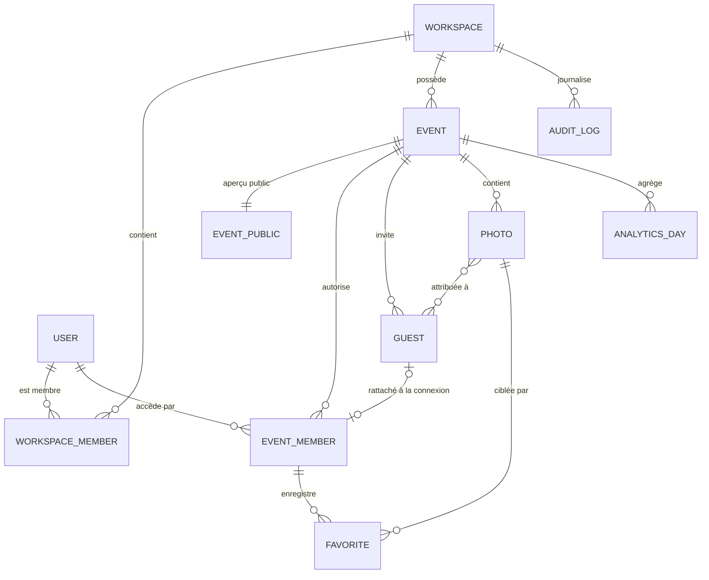
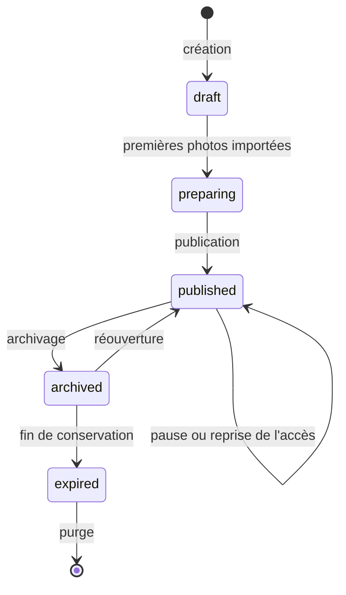

# MEMORIA — Schéma de données (DATABASE_SCHEMA)

> **Statut : proposé, en attente de validation** (décisions D-02, D-03, D-04, D-07, D-08 du [rapport d'analyse](RAPPORT_ANALYSE_CLAUDE.md)).
> Ce modèle « V3 » consolide les deux modèles de la conversation : V1 (cahier §12) et V2 (message 6).

## 1. De V1 et V2 à V3

| Sujet | V1 — cahier §12 | V2 — message 6 | V3 — proposé | Raison |
|---|---|---|---|---|
| Rôle de l'utilisateur | `users.role` | `users.platformRole` | Aucun rôle dans `users` | Un rôle modifiable par son titulaire est une faille ; un compte peut être photographe ici et invité ailleurs |
| Invité avant connexion | — | — | `events/{E}/guests/{guestId}` | L'UID n'existe pas au moment de l'attribution |
| Appartenance | `members/{uid}` | `members/{uid}` | `members/{uid}`, tous rôles confondus | Un seul document à lire pour connaître le rôle |
| Invitation | `invitations/{id}` | `invitations/{id}` + `tokenHash` | Champs de la fiche `guests` | La preuve est l'email vérifié ; un seul document par invité |
| Attribution | `photos.assignedUids[]` | `photos/{id}/assignments/{uid}` | `photos.assignedGuestIds[]` (≤ 200) | Une requête par album ; 2 lectures dans les règles Storage |
| Album | `albums/{id}` + `photoIds[]` | `albums/{id}` sans tableau | Vue : requête + champs sur `guests` | Pas de doublon possible, pas de grand tableau |
| Favoris | `events/{E}/favorites/{id}` | idem | `members/{uid}/favorites/{photoId}` | Privés par construction, sans doublon |
| Aperçu public | — | — | `eventPublic/{slug}` | Page d'accueil avant connexion, sans exposer l'événement |
| Journal d'audit | — | — | `workspaces/{W}/auditLogs/{id}` | Exigé par le cahier §14.3 |

Ce qui est conservé tel quel de V2 : `workspaces`, `workspaces/{W}/members`, `events` à la racine avec `workspaceId`, les trois chemins de fichiers par photo, `analytics/{periodId}`, et les deux principes « pas de `photoIds[]` dans l'album » et « l'album n'est pas une autorisation ».

## 2. Relations des collections



## 3. Collections

Convention : « Écrit par » indique qui a le droit d'écrire selon les règles de sécurité. Tous les horodatages sont des horodatages serveur, vérifiés par les règles.

### `users/{uid}`

Profil minimal, créé à la première connexion.

| Champ | Type | Remarque |
|---|---|---|
| `displayName`, `email`, `photoURL` | string | Recopiés du compte Google |
| `locale` | string | `fr` par défaut |
| `createdAt`, `lastLoginAt` | timestamp | |

Écrit par : le titulaire uniquement. Lu par : le titulaire. **Aucun champ de rôle ni de statut.**
Le super administrateur est désigné par un *custom claim* `platformAdmin` posé par un script d'administration, jamais par ce document.

### `workspaces/{workspaceId}`

L'espace professionnel d'un photographe ou d'un studio : la frontière d'isolation.

| Champ | Type | Remarque |
|---|---|---|
| `ownerUid` | string | Immuable après création |
| `name`, `slug` | string | |
| `logoPath`, `branding` | string, map | Identité visuelle |
| `plan` | `'trial' \| 'starter' \| 'premium' \| 'studio'` | Modifiable par le super administrateur seulement |
| `status` | `'pending' \| 'active' \| 'suspended'` | `pending` à la création ; activation par le super administrateur (D-05) |
| `usage` | map `{ storageBytes, photoCount, eventCount }` | Compteurs agrégés |
| `createdAt` | timestamp | |

Écrit par : le propriétaire (champs descriptifs), le super administrateur (`plan`, `status`). Lu par : ses membres, le super administrateur.

### `workspaces/{workspaceId}/members/{uid}`

| Champ | Type | Remarque |
|---|---|---|
| `role` | `'owner' \| 'collaborator'` | |
| `permissions` | map `{ manageEvents, uploadPhotos, manageAlbums, manageGuests }` | Les quatre permissions du cahier §2.1.C ; toutes vraies pour le propriétaire |
| `status` | `'active' \| 'disabled'` | |
| `email`, `displayName`, `addedAt`, `addedBy` | | |

Écrit par : le propriétaire. Un collaborateur ne peut pas modifier sa propre fiche.

### `workspaces/{workspaceId}/auditLogs/{logId}`

Journal en ajout seul : attribution et retrait de photos, changement de visibilité, révocation, changement de rôle, publication.
Champs : `action`, `actorUid`, `eventId`, `target`, `details`, `at`. Création par le personnel ; ni modification ni suppression.

### `events/{eventId}`

| Champ | Type | Remarque |
|---|---|---|
| `workspaceId` | string | **Immuable** |
| `title`, `eventType`, `peopleNames`, `date`, `location`, `description` | | Cahier §4.1 |
| `slug` | string | Avec suffixe aléatoire (D-08) |
| `coverPath` | string | Privé : visible après connexion |
| `theme` | map `{ universe, colors }` | Univers étoilé de l'événement |
| `welcomeMessage` | string | |
| `status` | `'draft' \| 'preparing' \| 'published' \| 'archived' \| 'expired'` | Voir §6 |
| `guestAccessPaused` | boolean | « Désactiver temporairement l'accès » |
| `collectiveGalleryEnabled` | boolean | |
| `originalsEnabled` | boolean | Envoi et téléchargement des originaux (D-07) |
| `retentionUntil` | timestamp \| null | Durée de conservation |
| `counters` | map `{ photoCount, guestCount, acceptedCount }` | Compteurs agrégés |
| `createdAt`, `createdBy`, `publishedAt`, `updatedAt` | | |

Écrit par : le personnel autorisé (`manageEvents`). Lu par : le personnel et les membres actifs de l'événement.

### `eventPublic/{slug}`

Ce que l'on peut voir **sans être connecté** en ouvrant le lien ou le QR code. Écrit par le personnel à la publication, supprimé à l'archivage.

| Champ | Type | Remarque |
|---|---|---|
| `eventId` | string | |
| `title`, `date` | | Chacun affichable ou non, au choix du photographe |
| `theme` | map | Pour afficher le ciel étoilé de l'événement |
| `photographerName`, `photographerLogoPath` | string | Signature |

Aucune photo, aucun nom d'invité, aucun lieu.

### `events/{eventId}/guests/{guestId}`

La liste d'invités du photographe : une personne, son invitation et son album.

| Champ | Type | Remarque |
|---|---|---|
| `firstName`, `lastName` | string | |
| `email` | string | Tel que saisi |
| `emailKey` | string | Email normalisé, utilisé pour le rattachement |
| `accessLevel` | `'guest' \| 'couple'` | « Niveau d'accès » du cahier §7.1 |
| `canViewCollective`, `canDownload` | boolean | Droits individuels |
| `invitationStatus` | `'pending' \| 'sent' \| 'accepted' \| 'expired' \| 'revoked'` | Les cinq statuts du cahier §7.3 |
| `invitedAt`, `expiresAt`, `acceptedAt` | timestamp | |
| `uid` | string \| null | Renseigné au rattachement |
| `album` | map `{ title, photoCount, coverPhotoId }` | Exemple : « Souvenirs de Wael », 35 photos |

Écrit par : le personnel (`manageGuests`) ; le rattachement par la fonction `claimInvitations`. Lu par : le personnel ; un invité ne lit **que sa propre fiche**. La liste n'est jamais lisible par les invités.

### `events/{eventId}/members/{uid}`

**Le document d'autorisation.** Une entrée par compte ayant accès à l'événement, personnel compris. C'est le premier document lu par toutes les règles.

| Champ | Type | Remarque |
|---|---|---|
| `uid` | string | Égal à l'identifiant du document |
| `workspaceId` | string | Recopié de l'événement |
| `role` | `'owner' \| 'collaborator' \| 'couple' \| 'guest'` | |
| `permissions` | map | Personnel uniquement |
| `guestId` | string | Mariés et invités : la fiche rattachée |
| `status` | `'active' \| 'revoked'` | Révocation individuelle |
| `eventAccess` | `'open' \| 'closed'` | Reflet de l'état de l'événement (§6) |
| `canViewCollective`, `canDownload` | boolean | Recopiés de la fiche invité |
| `joinedAt` | timestamp | |

Écrit par : le personnel (entrées du personnel, révocation), la fonction `claimInvitations` (création pour un invité), la fonction `syncEventAccess` (`eventAccess`). **Jamais par l'invité lui-même.** Lu par : le titulaire et le personnel.

### `events/{eventId}/members/{uid}/favorites/{photoId}`

Champ : `createdAt`. L'identifiant du document est celui de la photo : pas de doublon possible. Lu et écrit par le titulaire uniquement.

### `events/{eventId}/photos/{photoId}`

`photoId` est dérivé de l'empreinte SHA-256 du fichier d'origine : réimporter le même fichier dans le même événement retombe sur le même document. La détection des doublons et la reprise d'un import interrompu en découlent.

| Champ | Type | Remarque |
|---|---|---|
| `workspaceId` | string | Immuable |
| `filename` | string | Nom d'origine |
| `paths` | map `{ thumbnail, display, original? }` | Chemins Storage |
| `width`, `height` | number | Pour réserver la place à l'écran avant chargement |
| `sizes` | map `{ thumbnail, display, original? }` | Octets ; alimente les compteurs de stockage |
| `category` | string | Les dix catégories du cahier §5.2 |
| `takenAt` | timestamp \| null | Lue dans les métadonnées EXIF ; sert à la timeline |
| `uploadedAt`, `uploadedBy` | | |
| `status` | `'uploading' \| 'ready' \| 'failed'` | Les fichiers ne sont acceptés par Storage que pendant `uploading` |
| `published` | boolean | Vrai seulement si `status == 'ready'` |
| `visibility` | `'private' \| 'personal' \| 'collective'` | Cahier §6.3 |
| `assignedGuestIds` | string[] (≤ 200) | Les invités dont l'album contient cette photo |

Lecture par un invité : la photo est publiée **et** (elle est collective et il a accès à la galerie, **ou** elle n'est pas privée et son `guestId` figure dans `assignedGuestIds`).

Sens exact des trois visibilités :

| Visibilité | Personnel | Invités attribués | Autres membres |
|---|---|---|---|
| `private` | Oui | Non | Non |
| `personal` | Oui | Oui (dans leur album) | Non |
| `collective` | Oui | Oui (album et galerie) | Oui (galerie) |

### `events/{eventId}/analytics/{yyyy-mm-dd}`

Compteurs agrégés par jour : `views`, `downloads`, `activeGuests`, `bytesServed`, `updatedAt`. Les tableaux de bord lisent ces documents, jamais la collection des photos.

## 4. Fichiers dans Cloud Storage

```text
workspaces/{workspaceId}/
  branding/logo.<ext>
  events/{eventId}/
    cover/cover.webp
    photos/{photoId}/
      thumbnail.webp        ≈ 400 px, ≈ 25 Ko      grilles
      display.webp          ≈ 2 048 px, ≈ 400 Ko   visionneuse
      original.<ext>        fichier exporté par le photographe, facultatif
```

Écarts avec le cahier §13 : `original.<ext>` au lieu de `original.webp` (un original n'est pas converti) ; repli en `.jpg` pour `thumbnail` et `display` si le navigateur ne sait pas encoder le WebP.

Les métadonnées EXIF disparaissent des versions `thumbnail` et `display` par ré-encodage. Pour `original`, le bloc GPS est retiré sans ré-encodage ; l'orientation et le profil de couleur sont conservés.

## 5. Index et requêtes

| Écran | Requête | Index composite |
|---|---|---|
| Mon album | `photos` où `assignedGuestIds` contient mon `guestId`, `published == true`, `visibility in [personal, collective]`, tri `takenAt` | `assignedGuestIds` (tableau), `published`, `visibility`, `takenAt` |
| Galerie collective | `photos` où `visibility == collective`, `published == true`, tri `takenAt` | `visibility`, `published`, `takenAt` |
| Galerie, filtre catégorie | idem + `category == X` | `visibility`, `published`, `category`, `takenAt` |
| Galerie administrative | `photos` de l'événement, tri `uploadedAt`, filtres `category`, `status` | `category`, `uploadedAt` ; `status`, `uploadedAt` |
| Mes événements (invité) | groupe de collections `members` où `uid == moi` et `status == active` | `uid`, `status` (portée groupe de collections) |
| Événements du workspace | `events` où `workspaceId == W`, tri `date` | `workspaceId`, `date` |
| Rattachement | groupe de collections `guests` où `emailKey == clé` (côté serveur) | `emailKey` (portée groupe de collections) |

Toutes les listes sont paginées par curseur, 40 à 60 documents par page. Aucune lecture de collection entière.

## 6. Machine d'états d'un événement



| État | Personnel | Invités |
|---|---|---|
| `draft`, `preparing` | Accès complet | **Aucun accès** ; le rattachement d'un invité est refusé |
| `published` | Accès complet | Accès selon leurs droits |
| `published` + pause | Accès complet | Accès suspendu |
| `archived` | Lecture | Aucun accès (à confirmer : Q-04) |
| `expired` | Lecture des métadonnées | Aucun accès ; fichiers en attente de purge |

L'accès des invités est ouvert si et seulement si `status == 'published'` et `guestAccessPaused == false`. Cette condition est recopiée dans le champ `eventAccess` de chaque appartenance par la fonction `syncEventAccess`, parce que les règles Storage ne peuvent pas lire un troisième document (voir [`06_SECURITY.md` §5](06_SECURITY.md)).

## 7. Invariants

1. `events.workspaceId` et `photos.workspaceId` ne changent jamais.
2. Une appartenance `members/{uid}` d'invité n'existe que si une fiche `guests` porte ce `uid`.
3. `published == true` implique `status == 'ready'` : les fichiers nécessaires existent.
4. Un album n'est jamais une source d'autorisation : seuls `members` et `photos` le sont.
5. Les compteurs sont des agrégats de confort ; aucun contrôle d'accès n'en dépend.
6. Aucun document lisible par un invité ne contient le nom ou l'email d'un autre invité.

## 8. Interfaces TypeScript (spécification)

Ces interfaces seront créées dans `src/types/` en phase 1. Elles sont données ici comme spécification.

```ts
import type { Timestamp } from 'firebase/firestore';

export type WorkspaceRole = 'owner' | 'collaborator';
export type WorkspaceStatus = 'pending' | 'active' | 'suspended';
export type Plan = 'trial' | 'starter' | 'premium' | 'studio';
export type EventRole = 'owner' | 'collaborator' | 'couple' | 'guest';
export type EventStatus = 'draft' | 'preparing' | 'published' | 'archived' | 'expired';
export type InvitationStatus = 'pending' | 'sent' | 'accepted' | 'expired' | 'revoked';
export type PhotoVisibility = 'private' | 'personal' | 'collective';
export type PhotoStatus = 'uploading' | 'ready' | 'failed';
export type PhotoCategory =
  | 'preparatifs' | 'ceremonie' | 'couple' | 'famille' | 'amis'
  | 'reception' | 'gateau' | 'soiree' | 'danse' | 'spontane';

export interface StaffPermissions {
  manageEvents: boolean;
  uploadPhotos: boolean;
  manageAlbums: boolean;
  manageGuests: boolean;
}

export interface UserDoc {
  displayName: string;
  email: string;
  photoURL: string | null;
  locale: string;
  createdAt: Timestamp;
  lastLoginAt: Timestamp;
}

export interface WorkspaceDoc {
  ownerUid: string;
  name: string;
  slug: string;
  logoPath: string | null;
  branding: { primaryColor?: string; signature?: string };
  plan: Plan;
  status: WorkspaceStatus;
  usage: { storageBytes: number; photoCount: number; eventCount: number };
  createdAt: Timestamp;
}

export interface WorkspaceMemberDoc {
  role: WorkspaceRole;
  permissions: StaffPermissions;
  status: 'active' | 'disabled';
  email: string;
  displayName: string;
  addedAt: Timestamp;
  addedBy: string;
}

export interface EventDoc {
  workspaceId: string;
  title: string;
  slug: string;
  eventType: string;
  peopleNames: string;
  date: Timestamp;
  location: string;
  description: string;
  coverPath: string | null;
  theme: { universe: string; colors: Record<string, string> };
  welcomeMessage: string;
  status: EventStatus;
  guestAccessPaused: boolean;
  collectiveGalleryEnabled: boolean;
  originalsEnabled: boolean;
  retentionUntil: Timestamp | null;
  counters: { photoCount: number; guestCount: number; acceptedCount: number };
  createdAt: Timestamp;
  createdBy: string;
  publishedAt: Timestamp | null;
  updatedAt: Timestamp;
}

export interface EventPublicDoc {
  eventId: string;
  title: string | null;
  date: Timestamp | null;
  theme: EventDoc['theme'];
  photographerName: string;
  photographerLogoPath: string | null;
}

export interface GuestDoc {
  firstName: string;
  lastName: string;
  email: string;
  emailKey: string;
  accessLevel: 'guest' | 'couple';
  canViewCollective: boolean;
  canDownload: boolean;
  invitationStatus: InvitationStatus;
  invitedAt: Timestamp | null;
  expiresAt: Timestamp | null;
  acceptedAt: Timestamp | null;
  uid: string | null;
  album: { title: string; photoCount: number; coverPhotoId: string | null };
}

export interface EventMemberDoc {
  uid: string;
  workspaceId: string;
  role: EventRole;
  permissions?: StaffPermissions;
  guestId?: string;
  status: 'active' | 'revoked';
  eventAccess: 'open' | 'closed';
  canViewCollective: boolean;
  canDownload: boolean;
  joinedAt: Timestamp;
}

export interface PhotoDoc {
  workspaceId: string;
  filename: string;
  paths: { thumbnail: string; display: string; original?: string };
  width: number;
  height: number;
  sizes: { thumbnail: number; display: number; original?: number };
  category: PhotoCategory | null;
  takenAt: Timestamp | null;
  uploadedAt: Timestamp;
  uploadedBy: string;
  status: PhotoStatus;
  published: boolean;
  visibility: PhotoVisibility;
  assignedGuestIds: string[];
}

export interface FavoriteDoc {
  createdAt: Timestamp;
}

export interface AnalyticsDayDoc {
  views: number;
  downloads: number;
  activeGuests: number;
  bytesServed: number;
  updatedAt: Timestamp;
}

export interface AuditLogDoc {
  action: string;
  actorUid: string;
  eventId: string | null;
  target: string;
  details: Record<string, unknown>;
  at: Timestamp;
}
```
