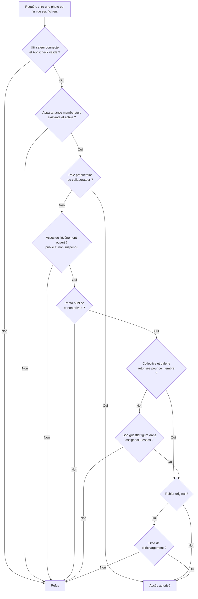
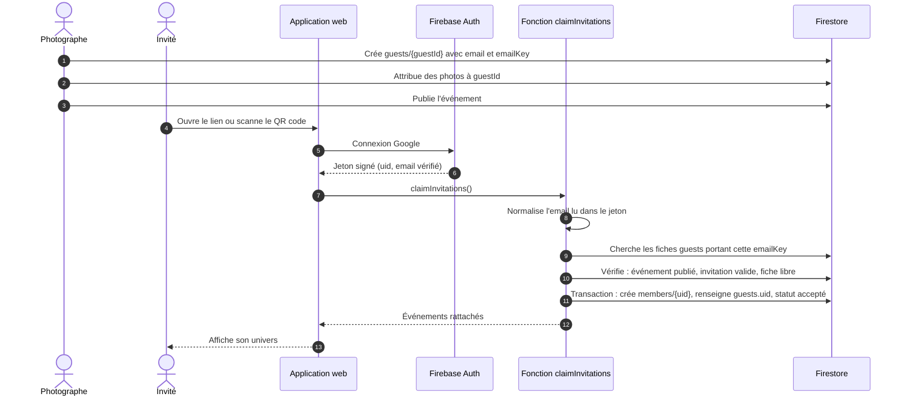

# MEMORIA — Sécurité et confidentialité (SECURITY)

> **Statut : proposé, en attente de validation** (décisions D-01, D-02, D-03, D-05, D-08, D-09 du [rapport d'analyse](RAPPORT_ANALYSE_CLAUDE.md)).
> Les règles ci-dessous sont une **spécification**. Les fichiers `firestore.rules` et `storage.rules` seront écrits en phase 1 et prouvés par les tests de [`08_TESTING.md`](08_TESTING.md).

## 1. Exigences non négociables (conversation)

Reprises du prompt de mission §5 et du cahier §14 :

1. Aucune galerie publique par défaut ; aucune lecture anonyme de photo.
2. Aucun accès croisé entre workspaces.
3. Aucun accès à l'album personnel d'un autre invité.
4. Permissions vérifiées côté serveur (règles Firestore et Storage, fonctions).
5. Pas d'URL permanente ni d'URL « cachée » comme mécanisme d'autorisation.
6. Protection contre la modification frauduleuse des rôles et contre les invitations falsifiées.
7. Révocation effective : un ancien lien ne donne plus rien.
8. App Check activé.
9. Tests négatifs pour chaque scénario de violation.
10. Aucun secret dans le frontend ni dans Git ; le développement ne peut pas toucher la production.

## 2. Acteurs et menaces

| Acteur | Ce qu'il pourrait tenter | Parade principale |
|---|---|---|
| Anonyme possédant un lien ou un QR code | Voir des photos, lire les noms des mariés, énumérer les événements | Rien sans connexion sauf l'aperçu public minimal ; adresses à suffixe aléatoire |
| Titulaire d'un compte Google non invité | Se déclarer invité, deviner des identifiants de photo | Appartenance créée côté serveur à partir de l'email vérifié ; chaque fichier contrôlé |
| Invité A | Ouvrir l'album de B, lire la liste des invités, accéder aux photos privées, s'attribuer un rôle | Autorisation par photo ; liste des invités illisible ; appartenance non modifiable par son titulaire |
| Invité révoqué | Réutiliser un ancien lien ou une ancienne adresse de fichier | Contrôle à chaque requête ; aucune URL porteuse de droits |
| Photographe d'un autre workspace | Lire ou écrire les événements d'un concurrent | `workspaceId` immuable, vérifié sur chaque document et chaque chemin de fichier |
| Collaborateur | Dépasser ses permissions, supprimer un événement, se promouvoir | Permissions lues côté serveur ; fiche de membre modifiable par le seul propriétaire |
| Client modifié (script, outils du navigateur) | Appeler directement Firestore et Storage en contournant l'interface | Les règles sont la seule barrière : l'interface et les routes ne protègent rien |
| Abus de ressources | Envoyer des gigaoctets, télécharger en boucle pour faire monter la facture | Activation des photographes, tailles plafonnées, App Check, alertes de budget |
| Super administrateur | Consulter des albums privés par commodité | Aucun accès aux événements ni aux photos par les règles |

## 3. Matrice des rôles

Reprend le tableau du message 6 et le complète pour les mariés et le super administrateur.

| Action | Propriétaire | Collaborateur | Mariés | Invité | Super admin |
|---|---|---|---|---|---|
| Créer un événement | Oui | Si `manageEvents` | Non | Non | Non |
| Modifier, publier, archiver | Oui | Si `manageEvents` | Non | Non | Non |
| Supprimer un événement | Oui | Non | Non | Non | Non |
| Importer des photos | Oui | Si `uploadPhotos` | Non | Non | Non |
| Attribuer, changer la visibilité | Oui | Si `manageAlbums` | Non | Non | Non |
| Gérer les invités, révoquer | Oui | Si `manageGuests` | Non | Non | Non |
| Voir les photos privées | Oui | Oui | Non | Non | Non |
| Voir les photos personnelles | Oui | Oui | À trancher (Q-02) | Les siennes | Non |
| Voir la galerie collective | Oui | Oui | Oui | Si autorisé | Non |
| Télécharger | Oui | Oui | Oui | Si `canDownload` | Non |
| Gérer les collaborateurs | Oui | Non | Non | Non | Non |
| Activer ou suspendre un workspace | Non | Non | Non | Non | Oui |
| Lire l'usage des workspaces | Le sien | Non | Non | Non | Oui |

## 4. Chaîne d'autorisation d'une photo

C'est l'arbre de décision du message 6, complété par l'état de l'événement et le droit de téléchargement. Il s'applique à l'identique au document Firestore de la photo et à chacun de ses fichiers.

Deux documents suffisent pour parcourir tout l'arbre : `events/{E}/members/{uid}` (étapes C, D, E, J) et `events/{E}/photos/{P}` (étapes F, G, I).

## 5. Le budget de lecture des règles Storage

Les règles Storage peuvent consulter Firestore (`firestore.get`, `firestore.exists`), mais **2 documents au plus par requête**. Plusieurs lectures du même document ne comptent qu'une fois. Les règles Firestore disposent de 10 lectures par requête.

Cette limite dicte trois choix du modèle :

| Besoin | Sans précaution | Choix retenu |
|---|---|---|
| Connaître le rôle, que l'on soit personnel ou invité | `workspaces/{W}/members` **puis** `events/{E}/members` : 2 documents avant même de regarder la photo | Tout compte ayant accès à un événement, personnel compris, a une entrée dans `events/{E}/members/{uid}` |
| Savoir si la photo est attribuée à l'invité | Sous-collection `assignments/{uid}` : un 3ᵉ document | `assignedGuestIds` dans le document de la photo |
| Savoir si l'événement est publié et non suspendu | Document `events/{E}` : un 3ᵉ document | Champ `eventAccess` recopié sur l'appartenance par la fonction `syncEventAccess` |

Chaque lecture faite par une règle est facturée comme une lecture Firestore : au plus 2 par fichier téléchargé. Voir [`07_FIREBASE_COSTS.md`](07_FIREBASE_COSTS.md).

### Lecture des fichiers sans URL

Le navigateur lit les fichiers par le SDK (`getBlob`), qui joint le jeton de l'utilisateur et le jeton App Check à la requête. Les règles sont évaluées à **chaque** requête.

| | `getDownloadURL` | URL signée 5 min (message 6) | Lecture directe (proposé) |
|---|---|---|---|
| Ce qui porte le droit d'accès | L'URL, pour toujours | L'URL, pendant 5 minutes | Le compte de l'utilisateur |
| Transférable à un tiers | Oui | Oui, pendant 5 minutes | Non |
| Révocation | Impossible sans régénérer le jeton | Après expiration | Immédiate |
| App Check sur les octets | Non | Non | Oui |
| Appels de fonction | 0 | 1 par image ou par page | 0 |
| Cache du navigateur | Oui | Non : l'URL change | Oui |
| Verdict | **Interdit** | Repli si H1 ou H2 échoue | **Retenu** |

`getDownloadURL` n'est appelé nulle part dans le code. Une règle de lint l'interdit, et un seul composant est chargé d'afficher une image privée.

## 6. Rattachement d'une invitation à un compte

Garanties :

- **L'email n'est jamais lu dans la requête.** La fonction le prend dans le jeton vérifié par Firebase Auth, et exige `email_verified` et le fournisseur Google.
- **L'invité ne peut pas créer son appartenance lui-même.** Les règles Firestore interdisent toute écriture de `members` par un invité.
- **Une fiche ne se rattache qu'une fois.** Si `guests.uid` est déjà renseigné par un autre compte, la demande est refusée ; seul le photographe peut libérer la fiche.
- **Rien avant publication.** Tant que l'événement n'est pas publié, aucun rattachement n'est possible : c'est ce qui garantit qu'un événement non publié n'est jamais accessible.
- **Invitation expirée ou révoquée :** refus.
- **Un compte, plusieurs événements :** un seul appel rattache toutes les invitations en attente de cet email.

Normalisation de l'email (`emailKey`), appliquée à la saisie et dans la fonction : minuscules et suppression des espaces ; pour `gmail.com` et `googlemail.com`, suppression des points et de la partie `+alias`, domaine ramené à `gmail.com`. La fonction recalcule la clé à partir du champ `email` de la fiche : elle ne fait pas confiance à l'`emailKey` écrit par le client.

Cas d'échec à traiter dans l'interface : « Vous êtes connecté avec *adresse*. Aucune invitation ne correspond à cette adresse. » avec le moyen de changer de compte.

## 7. Règles Firestore — spécification

Principe : **tout est refusé par défaut** ; chaque autorisation est écrite explicitement et couverte par un test positif et un test négatif.

| Chemin | Lecture | Écriture |
|---|---|---|
| `users/{uid}` | Titulaire | Titulaire ; champs limités à la liste blanche |
| `workspaces/{W}` | Membres actifs, super admin | Création par un utilisateur connecté, pour lui-même, `status: pending`, un seul workspace possédé ; modification par le propriétaire, hors `ownerUid`, `plan`, `status` ; `plan` et `status` par le super admin |
| `workspaces/{W}/members/{uid}` | Membres du workspace | Propriétaire uniquement ; l'entrée du propriétaire est créée avec le workspace et ne peut pas être retirée |
| `workspaces/{W}/auditLogs/{id}` | Propriétaire | Création par le personnel, `actorUid` = auteur, `at` = heure serveur ; ni modification ni suppression |
| `events/{E}` | Personnel ; membres actifs si l'accès est ouvert | Personnel avec `manageEvents`, workspace actif ; `workspaceId` immuable ; suppression par le propriétaire |
| `eventPublic/{slug}` | Tout le monde (avec App Check) | Personnel de l'événement désigné ; champs limités |
| `events/{E}/guests/{G}` | Personnel ; l'invité rattaché pour sa seule fiche | Personnel avec `manageGuests` ; `uid` jamais écrit par le client |
| `events/{E}/members/{uid}` | Titulaire ; personnel | Personnel pour les entrées du personnel et pour `status` ; **jamais le titulaire** |
| `…/members/{uid}/favorites/{P}` | Titulaire | Titulaire, membre actif |
| `events/{E}/photos/{P}` | Selon la chaîne du §4 | Personnel : création avec `uploadPhotos` ; attribution et visibilité avec `manageAlbums` ; `assignedGuestIds` ≤ 200 ; `published` exige `status == ready` |
| `events/{E}/analytics/{jour}` | Personnel | Membres actifs : incréments bornés uniquement |
| Tout le reste | Refusé | Refusé |

Les listes sont soumises aux mêmes règles que les lectures unitaires : une requête qui pourrait renvoyer un document interdit est rejetée en bloc. L'invité ne peut donc lister que « ses » photos ou la galerie collective, avec les filtres correspondants.

## 8. Règles Storage — spécification

Chemin : `workspaces/{W}/events/{E}/photos/{P}/{fichier}`.

| Opération | Condition |
|---|---|
| Lecture d'un fichier | Chaîne du §4 ; le `workspaceId` de l'appartenance et de la photo doit être `W` |
| Liste d'un dossier | Refusée pour tous : c'est la parade à l'énumération |
| Écriture | Personnel de l'événement avec `uploadPhotos` ; le document de la photo existe, est en `status: uploading` et a été créé par l'auteur ; type `image/jpeg`, `image/png` ou `image/webp` ; taille plafonnée par variante |
| Remplacement | Refusé une fois la photo `ready` : un fichier publié est immuable |
| Suppression | Personnel avec `manageEvents` |

Plafonds de taille proposés : `thumbnail` 200 Ko, `display` 2 Mo, `original` 40 Mo.
La couverture et le logo suivent la même logique, avec une lecture réservée aux membres de l'événement ou du workspace.

Un workspace suspendu ou en attente ne peut plus importer : la création du document de la photo, préalable obligatoire à tout envoi de fichier, est refusée par les règles Firestore.

## 9. Révocation, pause, archivage

| Action | Mécanisme | Délai |
|---|---|---|
| Révoquer un invité | `members.status = revoked`, `guests.invitationStatus = revoked` | Immédiat, à la requête suivante |
| Retirer une photo d'un album | Retrait du `guestId` de `assignedGuestIds` | Immédiat |
| Rendre une photo privée ou la dépublier | Champ de la photo | Immédiat |
| Suspendre ou archiver un événement | Champ de l'événement, recopié sur les appartenances par `syncEventAccess` | Quelques secondes ; les listes et métadonnées sont coupées immédiatement par les règles Firestore |
| Désactiver un collaborateur | `workspaces/{W}/members.status = disabled` et retrait de ses appartenances aux événements | Immédiat pour Firestore ; à la fin du lot pour Storage |
| Bloquer un compte | Désactivation du compte dans Firebase Auth | Une heure au plus (durée de vie du jeton) |

Une image déjà affichée ou enregistrée par un invité reste entre ses mains : aucune technique web ne l'empêche. La révocation ferme l'accès futur.

## 10. Authentification

- **Fournisseur unique : Google.** Les autres fournisseurs restent désactivés.
- **Connexion par fenêtre sur ordinateur, par redirection sur mobile.** Pour que la redirection fonctionne dans les navigateurs qui bloquent le stockage tiers, le domaine d'authentification (`authDomain`) est le domaine de l'application, servi par Firebase Hosting.
- **Navigateurs intégrés** (Messenger, Instagram, Facebook) : Google y refuse la connexion. L'application les détecte et invite à ouvrir la page dans le navigateur du téléphone.
- **Routes protégées dans l'interface** : confort uniquement. La protection réelle est dans les règles.
- **Super administrateur** : *custom claim* `platformAdmin`, posé par un script local utilisant un compte de service qui n'est jamais versionné.

## 11. App Check

- Fournisseur : reCAPTCHA Enterprise pour le web.
- Appliqué à Firestore, Storage et Functions.
- Déploiement en deux temps : mode observation, puis mode strict une fois les métriques propres (phase 7).
- Développement et intégration continue : émulateurs (App Check n'y est pas requis) ou jetons de débogage, jamais versionnés.

App Check réduit les abus automatisés ; il ne remplace aucune règle.

## 12. Secrets et environnements

- La configuration web Firebase (`apiKey`, etc.) n'est pas un secret : elle identifie le projet et ne donne aucun droit.
- Les vrais secrets (clé du service d'email, compte de service) vivent dans le gestionnaire de secrets de Functions ou sur le poste de l'administrateur. `.env*` est ignoré par Git ; seul `.env.example` est versionné.
- Les tests et le développement utilisent un identifiant de projet `demo-memoria` : avec ce préfixe, les outils Firebase ne contactent aucun projet réel. Les scripts de test refusent de démarrer avec un autre identifiant.
- Le déploiement en production est une commande distincte, jamais déclenchée par les tests.

## 13. En-têtes et hébergement

Configurés dans `firebase.json` : politique de sécurité du contenu (CSP) limitée à l'application et aux domaines Firebase et Google nécessaires, `Referrer-Policy: no-referrer` pour ne pas faire fuiter l'adresse d'un événement, `X-Content-Type-Options: nosniff`, interdiction d'affichage dans un cadre tiers.

## 14. Journalisation

Chaque changement de droits écrit une entrée dans `workspaces/{W}/auditLogs` : attribution, retrait, visibilité, révocation, rôle, publication. Au MVP, l'entrée est écrite par le client dans le même lot que le changement. En phase pro, elle sera écrite par une fonction pour être infalsifiable.

## 15. Confidentialité et conformité

Prévu par le cahier §14.4 et repris dans la feuille de route : information et consentement des personnes, politique de confidentialité, conditions d'utilisation, durée de conservation configurable, suppression d'un événement et d'un compte, export des données, procédure de signalement.

Points à faire valider par un juriste **avant toute commercialisation** (je ne suis pas juriste) :

- Loi organique tunisienne n° 2004-63 du 27 juillet 2004 et obligations auprès de l'INPDP, notamment pour un hébergement des données hors de Tunisie.
- Applicabilité du RGPD lorsque des invités ou des clients résident dans l'Union européenne.
- Photos de mineurs et droit à l'image.
- Répartition des rôles : le photographe décide de ce qui est publié et à qui ; MEMORIA héberge pour son compte.

La reconnaissance faciale traite des données biométriques : elle reste hors de la V1 et dépendra de cette validation.

## 16. Risques résiduels assumés au MVP

| Risque | Pourquoi il est accepté | Traitement prévu |
|---|---|---|
| Compteurs et journal écrits par le client, donc falsifiables par le photographe lui-même | Aucun droit d'accès n'en dépend ; les photographes sont activés manuellement | Compteurs et journal côté serveur en phase pro |
| Pas de limite de débit par utilisateur | Les règles ne savent pas compter ; l'accès exige une invitation | App Check, alertes de budget, coupure d'urgence |
| Les invités d'une même photo voient les identifiants opaques des autres invités attribués | Aucun nom ni email n'est lisible | Aucun |
| Une image vue peut être copiée | Inhérent au web | Filigrane optionnel en phase pro |
